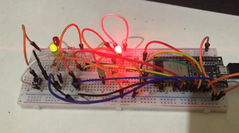

# 🚦 Semáforo Inteligente com ESP32


Protótipo de semáforo inteligente desenvolvido em C++ com ESP32 e framework Arduino. O sistema adapta o tempo do sinal verde de duas vias com base na contagem de veículos simulada por botões.

## 🎥 Demonstração



## 🎯 Objetivo

Explorar conceitos de sistemas embarcados e desenvolver uma lógica de controle de tráfego capaz de ajustar o tempo de sinal verde conforme o fluxo de veículos detectado em duas vias.

## ⚙️ Funcionalidades

- Controle de dois semáforos independentes.
- Simulação de sensores de veículos por meio de botões.
- Contagem de acionamentos utilizando interrupções de hardware.
- Contagem de veículos durante os primeiros 15 segundos de cada fase verde.
- Comparação com o fluxo registrado na fase verde anterior da outra via.
- Ajuste do tempo total de sinal verde para 30, 35 ou 40 segundos.
- Exibição das contagens e dos tempos calculados pelo Monitor Serial.
- Tratamento de acionamentos repetidos por meio de debounce.

## 🧠 Lógica de funcionamento

O sistema alterna o sinal verde entre as vias A e B. Durante os primeiros 15 segundos de cada fase verde, os acionamentos do botão correspondente são contabilizados.

Ao fim desse intervalo, o fluxo atual é comparado com o fluxo registrado nos primeiros 15 segundos do verde anterior da outra via. Com base nessa comparação, o sistema determina a duração total do sinal verde.

### Regras de temporização

| Relação entre os fluxos | Tempo total de verde |
|---|---:|
| Fluxo atual ≤ 1,3 × fluxo anterior | 30 segundos |
| 1,3 × fluxo anterior < fluxo atual ≤ 1,6 × fluxo anterior | 35 segundos |
| Fluxo atual > 1,6 × fluxo anterior | 40 segundos |

O tempo inicial de contagem de 15 segundos faz parte do tempo total de verde. Portanto, após a contagem, o sistema mantém o verde por mais 15, 20 ou 25 segundos, conforme a decisão calculada.

Quando o fluxo anterior é zero, o sistema aplica uma regra especial: se ambos os fluxos forem zero, seleciona 30 segundos; caso contrário, seleciona 40 segundos.

Após a fase verde, o semáforo correspondente passa para amarelo durante 3 segundos antes da troca de via.

## 🔌 Mapeamento dos pinos

| Componente | GPIO | Função |
|---|---:|---|
| Via A — Vermelho | 26 | Indica parada |
| Via A — Amarelo | 27 | Indica transição |
| Via A — Verde | 14 | Indica passagem |
| Botão/Sensor A | 13 | Simula a detecção de veículo |
| Via B — Vermelho | 32 | Indica parada |
| Via B — Amarelo | 33 | Indica transição |
| Via B — Verde | 25 | Indica passagem |
| Botão/Sensor B | 34 | Simula a detecção de veículo |

**Nota sobre o hardware:** o GPIO 34 do ESP32 é somente de entrada e não possui pull-up interno. A entrada deve utilizar o resistor externo previsto na montagem do circuito.

## 🧰 Componentes utilizados

- Placa ESP32 Dev Module.
- 6 LEDs para representar os dois semáforos.
- Resistores limitadores de corrente para os LEDs.
- 2 botões para simular a detecção de veículos.
- Resistores externos necessários para as entradas dos botões.
- Protoboard e jumpers.
- Cabo USB para alimentação e programação.

## 💻 Tecnologias

- C++
- ESP32
- Arduino Framework
- PlatformIO
- Visual Studio Code
- Interrupções de hardware
- Entradas e saídas digitais
- Temporização e lógica de decisão

## 🚀 Como executar

### Pré-requisitos

- Visual Studio Code.
- Extensão PlatformIO IDE.
- Placa ESP32 compatível.
- Circuito montado conforme o mapeamento dos pinos.

### Instalação

1. Clone o repositório:

   ```bash
   git clone https://github.com/jeffersonnasciment0/semaforo-inteligente-esp32.git
   ```

2. Abra a pasta do projeto no Visual Studio Code.

3. Aguarde o PlatformIO preparar o ambiente.

4. Conecte o ESP32 ao computador.

5. Compile e carregue o firmware utilizando os comandos de build e upload do PlatformIO.

6. Abra o Monitor Serial com a velocidade de **115200 baud** para acompanhar as contagens e os tempos calculados.

## 📁 Estrutura do projeto

```text
semaforo-inteligente-esp32/
├── docs/
│   ├── semaforo.gif
│   └── semaforo.mp4
├── include/
├── lib/
├── src/
│   └── main.cpp
├── test/
├── .gitignore
├── platformio.ini
└── README.md
```

## 📚 Conceitos praticados

- Programação de sistemas embarcados em C++.
- Configuração de GPIOs.
- Interrupções de hardware.
- Contagem de eventos com variáveis compartilhadas.
- Debounce de entradas digitais.
- Controle temporal de sinais.
- Comparação de dados e tomada de decisão.
- Desenvolvimento e compilação com PlatformIO.

## 👨‍💻 Autor

**Jefferson Santos**

[GitHub](https://github.com/jeffersonnasciment0)

---

*Projeto educacional desenvolvido para praticar programação embarcada e controle adaptativo de semáforos.*